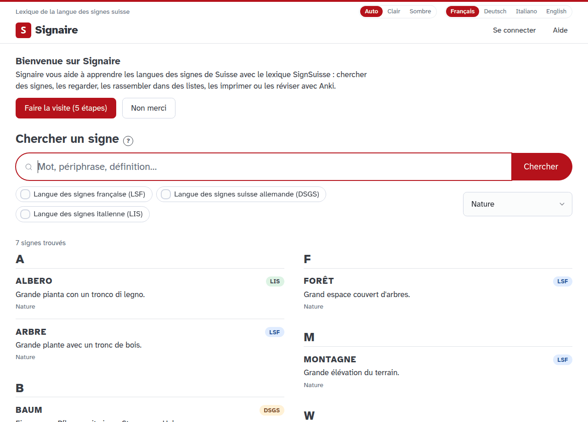
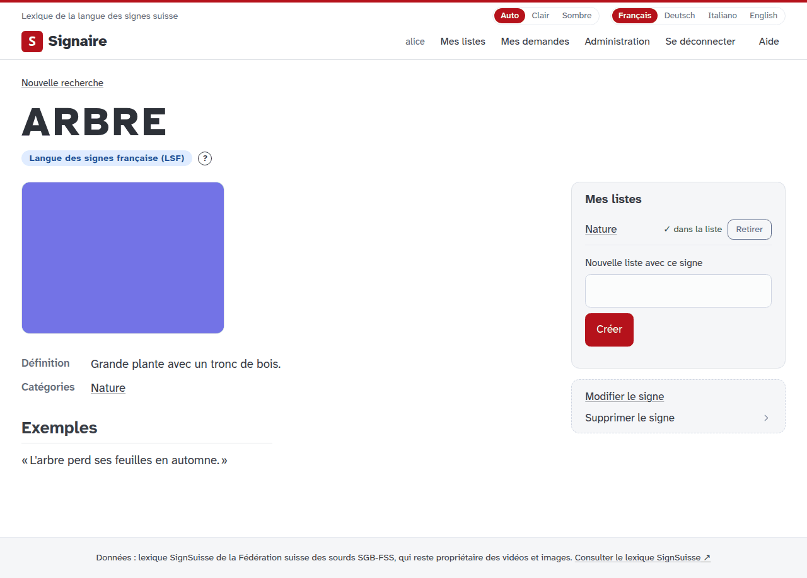
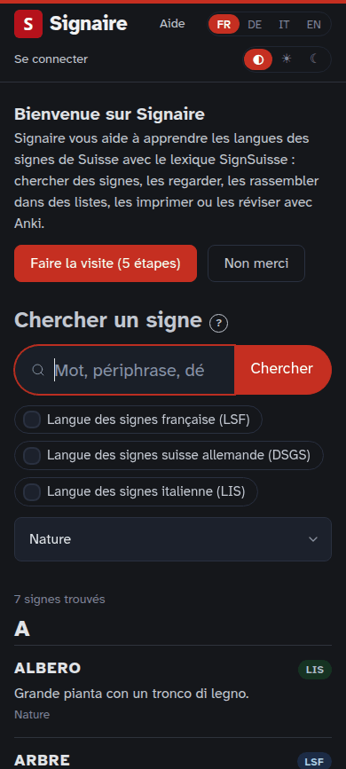
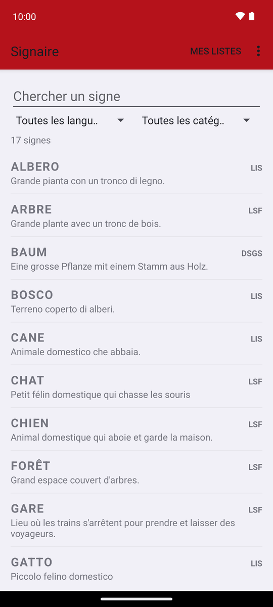
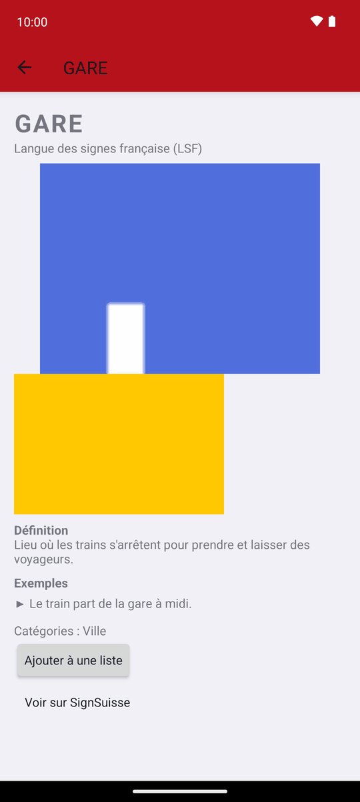
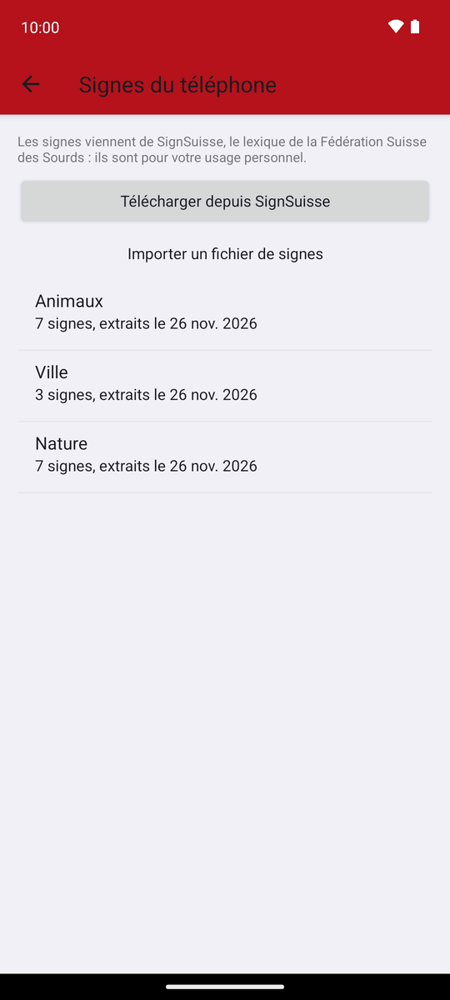

# Signaire

[](https://github.com/gehel/signaire/actions/workflows/build.yml?query=branch%3Amain)
[](https://github.com/gehel/signaire/actions/workflows/quality.yml?query=branch%3Amain)
[](https://sonarcloud.io/summary/new_code?id=gehel_signaire)
[](https://sonarcloud.io/component_measures?id=gehel_signaire&metric=coverage)
[](https://sonarcloud.io/summary/overall?id=gehel_signaire)
[](LICENSE)
[](#quick-start)
[](docs/design/android.md)
[](docs/design/i18n.md)
[](.lighthouserc.json)

Signaire is a tool to learn and look up signs of the Swiss sign languages (LSF, DSGS, LIS), built on the
[SignSuisse](https://www.sgb-fss.ch/signsuisse/fr) lexicon of the Swiss Federation of the Deaf (SGB-FSS).

- **Search** signs by name, periphrase, definition or example, in one or several sign languages and
  categories, and watch their videos.
- **Word lists**: each user keeps lists of signs ("signs I'm learning", "signs for work"…), filled from sign
  pages or from search results.
- **Exports** of a list or a search: printable PDF (A4, A5, A6, 1 to 12 signs per page, booklet to fold,
  double-sided flashcards; each sign has a QR code to its video), [Anki](https://apps.ankiweb.net) deck
  (sign → word and word → sign cards), EPUB e-book.
- **Administration**: add, edit and delete signs; upload and reload bundles; synchronize with SignSuisse;
  handle the signs requested by users.
- **Android app** (Android 14 and later): the signs on the phone, downloaded from SignSuisse or imported, searched
  offline, and word lists.
- Web interface and command line in **French, German, Italian and English**.

## Screenshots

The web application and the Android app, in French, with the invented signs of the tests: their pictures and videos
are plain colors, where Signaire shows those of SignSuisse. `BrowserIT` and `AndroidIT` take these screenshots, and
others, in `signaire-it/target/screenshots/`.

<p>
  
  
</p>
<p>
  
  
  
  
</p>

## The data is not included

The content of SignSuisse (videos, images, texts) belongs to the SGB-FSS and may only be reused with its
written permission. Signaire distributes **code only**: each user extracts the data for their own use, with
`signaire extraire` or the synchronization page of the administration. Extracted data must not be shared.

## Quick start

You need Java 27 and Docker.

```bash
docker compose up -d                       # PostgreSQL for development
./mvnw -PnoVerify package -DskipTests      # build everything

# extract a category from SignSuisse into ~/.local/share/signaire/bundles (add --sans-medias for a quick try)
java -jar signaire-cli/target/signaire-cli-1.0-SNAPSHOT-jar-with-dependencies.jar extraire -c religion -l fr

# start the web application: it loads the bundles at startup
java -jar signaire-web/target/signaire-web-1.0-SNAPSHOT.jar --signaire.accounts.admins=myname
```

Then open <http://localhost:8080>, create an account named `myname` (it is an administrator), and search. The
manual is in the application ("Aide", `/help`); its pages are in `signaire-web/src/main/resources/help/`.

## Standalone application

For one computer, without server, Docker nor database to install: the accounts are in an H2 database and the search
index in Lucene, in the user's directories.

```bash
./mvnw -PnoVerify -pl signaire-web -am package -DskipTests
java -jar signaire-web/target/signaire-web-1.0-SNAPSHOT-standalone.jar   # or a double click on the jar
ci/package-standalone.sh signaire-web/target/signaire-web-1.0-SNAPSHOT-standalone.jar target/package  # with its own Java, starts faster
```

It listens to <http://localhost:8180> only (`--server.port=…` changes it), opens the browser, and asks on its first run
whether one person uses it (no account: they are the administrator) or several, and which signs to download from
SignSuisse. CI builds the package with its Java runtime for Linux, Windows and macOS (`signaire-standalone-*`
artifacts). The manual has a page about it (`/help/standalone`).

## Command line

```bash
alias signaire='java -jar signaire-cli/target/signaire-cli-1.0-SNAPSHOT-jar-with-dependencies.jar'
signaire --help
signaire extraire --categorie ville,nature --langue fr                     # SignSuisse → bundles
signaire charger                                                          # bundles → search index
signaire chercher lac --langue fr                                         # search
signaire exporter -f pdf -o lac.pdf --papier a5 --mise-en-page livret lac # export
```

The command line follows the language of the system (`LANG`, or `-Duser.language=de`).

## Configuration of the web application

Spring Boot properties, given on the command line (`--name=value`), in `~/.config/signaire/application.properties`
(read by the command line too), in an `application.properties` next to the jar, or as environment variables.
Signaire follows the [XDG base directories](https://specifications.freedesktop.org/basedir/latest/) on Linux
(`$XDG_DATA_HOME`, `$XDG_CONFIG_HOME`, `$XDG_CACHE_HOME`, `$XDG_STATE_HOME`), and the usual directories on macOS
(`~/Library/…/Signaire`) and Windows (`%APPDATA%`, `%LOCALAPPDATA%`).

| Property | Default | |
|---|---|---|
| `signaire.bundles.directory` | `~/.local/share/signaire/bundles` | Bundles loaded at startup, and source of the media |
| `signaire.media.cache` | `~/.cache/signaire/media` | Media downloaded by extractions |
| `signaire.index.directory` | `~/.local/state/signaire/index` | Lucene search index, rebuilt from the bundles when needed |
| `signaire.bundles.load-on-startup` | `true` | |
| `signaire.accounts.admins` | | Usernames of the administrators, comma separated |
| `signaire.accounts.registration-enabled` | `true` | Whether anyone can create an account |
| `signaire.sync.interval` | `500ms` | Delay between two requests to SignSuisse |
| `signaire.signsuisse.contact` | | Your email address (or a URL), added to the `User-Agent` of the requests to SignSuisse so that they can reach you if Signaire loads their site too much. **Sent with every request**: SignSuisse and its host keep it in their logs. Recommended |
| `signaire.signsuisse.user-agent` | `Signaire (+https://github.com/gehel/signaire)` | Replaces the whole `User-Agent` |
| `spring.datasource.url`, `.username`, `.password` | local PostgreSQL of `compose.yaml` | |
| `spring.security.oauth2.client.*` | | OpenID Connect providers, see [CLAUDE.md](CLAUDE.md) |

## Architecture

A multi-module Maven build: `signaire-model` and `signaire-bundle` (signs and bundles, Android compatible),
`signaire-extractor` (SignSuisse), `signaire-core` (Lucene search, bundle loading, media),
`signaire-accounts` (PostgreSQL: accounts, lists, changes, requests), `signaire-export` (PDF, Anki, EPUB),
`signaire-cli` and `signaire-web` (Spring MVC, Thymeleaf, htmx). Signs travel in **bundles**: one zip per
SignSuisse category with the signs and their media; the search index can always be rebuilt from them.

## Development

```bash
./mvnw verify            # build with all the tests (Docker needed by signaire-it) and quality checks; unchanged modules are cached
./mvnw -PnoVerify verify # without the static analysis
./mvnw verify -Dmaven.build.cache.enabled=false  # everything, without the build cache
```

[CLAUDE.md](CLAUDE.md) documents the architecture, the conventions and the pitfalls of the build in detail;
[TODO.md](TODO.md) lists what comes next. Contributions follow the same rules: one branch per feature, tests
first (JUnit 5 and AssertJ), commits that tell a story.

## License

The code of Signaire is licensed under the [Apache License 2.0](LICENSE). This covers the code only: the content of
SignSuisse (videos, images, texts) belongs to the SGB-FSS, and is not part of Signaire.
